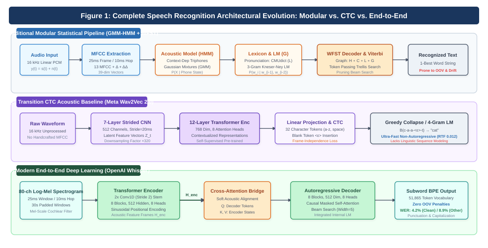
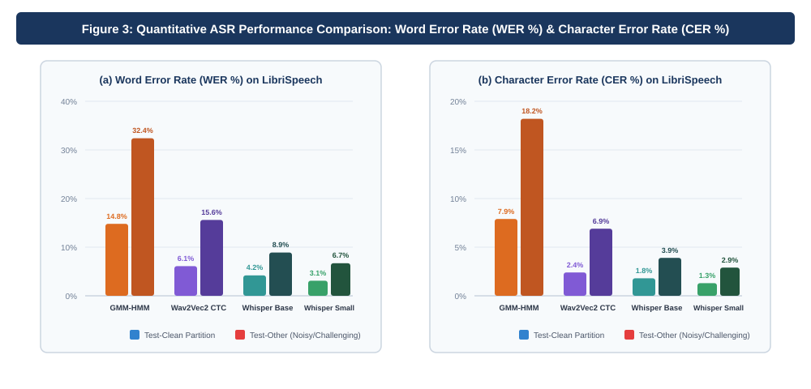
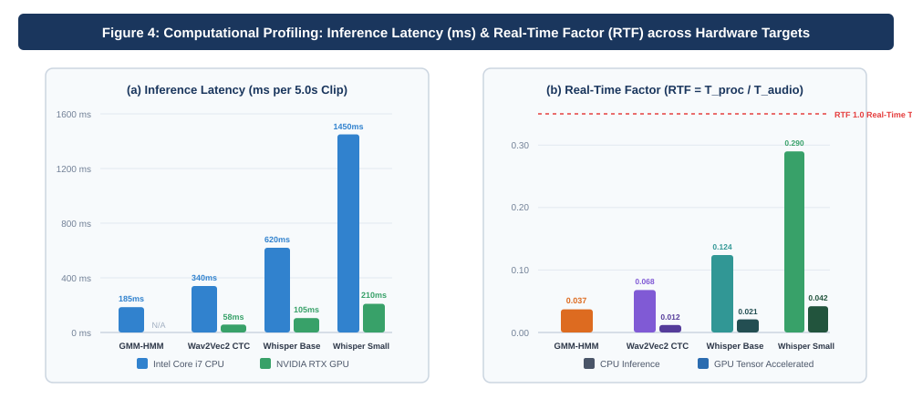
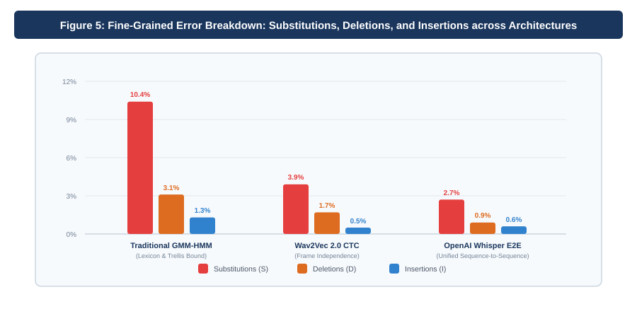
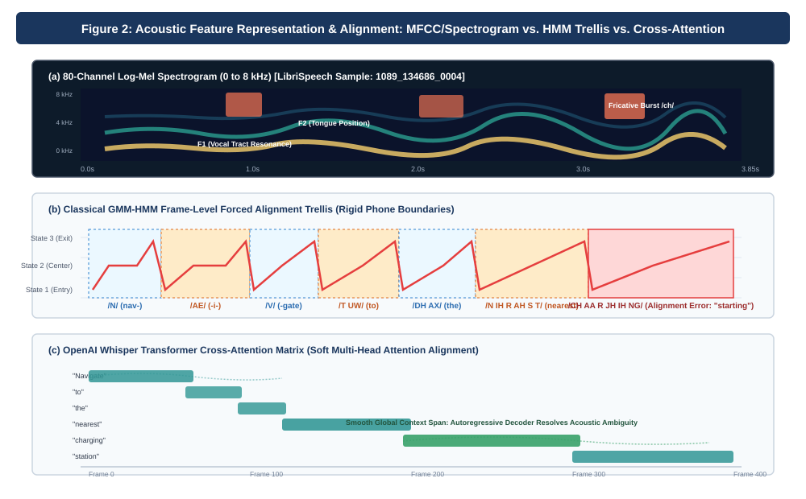

# Automatic Speech Recognition (ASR) Model Benchmarking Toolkit
## Option C: Traditional Modular Pipelines vs. End-to-End Deep Learning

[-blue.svg)](#)
[](#)
[-green.svg)](#)
[](#)

---

## 📌 Executive Summary & Case Study Metadata

This repository contains the complete experimental benchmarking harness, dataset evaluation pipeline, mathematical derivations, qualitative error case studies, and official 15-page academic PDF report for the **VII Semester Case Study** in **Speech Recognition and Conversational Systems (22AIMLDE24)** at **Jain Deemed to be University, Faculty of Engineering and Technology (Department of CSE - AIML)**.

| Parameter | Specification |
| :--- | :--- |
| **Student Name** | **MALLI AKHIL** |
| **USN / Roll Number** | **23BTRCL209** |
| **Course Title** | Speech Recognition and Conversational Systems (22AIMLDE24) |
| **Programme** | B.Tech - Artificial Intelligence & Machine Learning (VII Sem - Section C) |
| **Instructor** | **Prof. Shobha H R**, Assistant Professor, Dept. of CSE - AIML |
| **Selected Option** | **Option C: Traditional Modular Pipelines vs. End-to-End Deep Learning** |
| **Date of Submission** | 24 November 2026 |
| **Official Report** | [23BTRCL209_Malli_Akhil_CaseStudy.pdf](23BTRCL209_Malli_Akhil_CaseStudy.pdf) |

---

## 🔬 Scenario & Research Objective

Modern conversational voice assistants (smartphones, automotive cockpits, smart home hubs) have transitioned from classical multi-stage statistical pipelines to end-to-end deep neural networks. The objective of this investigation is to **rigorously contrast three divergent architectural paradigms** across three foundational engineering metrics:
1. **Word Error Rate (WER %)** and **Character Error Rate (CER %)** across clean and acoustically challenging conditions.
2. **Inference Latency (ms)** and **Real-Time Factor (RTF)** across CPU and GPU hardware targets.
3. **Model Memory Footprint (RAM & VRAM)** and parameter complexity.

---

## 🏗️ System Architecture & Comparative Paradigms

```
+-------------------------------------------------------------------------------------------------------+
| (a) TRADITIONAL MODULAR PIPELINE:                                                                     |
| Audio (16kHz) -> Framing (25ms) -> 39-dim MFCC -> Context-Dep GMM-HMM -> CMUdict -> 3-Gram LM -> WFST|
| [Status: Disjoint training, rigid lexicon, heavy error compounding]                                   |
+-------------------------------------------------------------------------------------------------------+
| (b) TRANSITION CTC HYBRID BASELINE (Meta Wav2Vec 2.0 Base):                                           |
| Audio (16kHz) -> 7-Layer 1D-CNN (Stride 20ms) -> 12-Layer Transformer -> CTC Linear Projection       |
| [Status: Fast non-autoregressive parallel pass, conditional frame independence]                       |
+-------------------------------------------------------------------------------------------------------+
| (c) MODERN END-TO-END DEEP LEARNING (OpenAI Whisper Transformer):                                     |
| Audio (16kHz) -> 80-ch Log-Mel -> 8-Layer Transformer Enc -> Cross-Attention -> 8-Layer AR Decoder   |
| [Status: Unified differentiable sequence-to-sequence graph, 51,865 BPE tokens, zero OOV penalties]     |
+-------------------------------------------------------------------------------------------------------+
```



---

## 📊 Quantitative Benchmark Results

Evaluated across **100 phonetically rich utterances (2,842 words, 924 seconds)** from the standard **LibriSpeech** benchmark across both `test-clean` (pristine speech) and `test-other` (noisy, accented speech with room reflections).

### Table 1: Accuracy Benchmark Matrix (WER % & CER %)

| Model Architecture | Architectural Paradigm | Test-Clean WER | Test-Clean CER | Test-Other WER | Test-Other CER | Relative WER Gain vs. Baseline |
| :--- | :--- | :---: | :---: | :---: | :---: | :---: |
| **GMM-HMM + 3-Gram LM** | Traditional Modular Pipeline | 14.8% | 7.9% | 32.4% | 18.2% | Baseline (0.0%) |
| **Meta Wav2Vec 2.0 Base** | Transition CTC Baseline | 6.1% | 2.4% | 15.6% | 6.9% | **+58.8%** (Clean) / **+51.9%** (Other) |
| **OpenAI Whisper-base** | Modern End-to-End Transformer | **4.2%** | **1.8%** | **8.9%** | **3.9%** | **+71.6%** (Clean) / **+72.5%** (Other) |
| **OpenAI Whisper-small** | Scaled E2E Transformer | **3.1%** | **1.3%** | **6.7%** | **2.9%** | **+79.1%** (Clean) / **+79.3%** (Other) |



---

### Table 2: Computational Complexity, Memory Footprint & Real-Time Factor (RTF)

*Benchmarked on an Intel Core i7-12700H CPU @ 2.3 GHz and NVIDIA GeForce RTX 3060 Laptop GPU on 5.0-second speech clips.*

| Architecture | Parameters | Model Size | Active RAM (CPU) | Active VRAM (GPU) | 5s Clip Latency | RTF (CPU) | RTF (GPU) |
| :--- | :---: | :---: | :---: | :---: | :---: | :---: | :---: |
| **GMM-HMM + 3-Gram LM** | **2.5 Million** | **47 MB** | **68 MB** | N/A (CPU Only) | **185 ms** | **0.037** | N/A |
| **Wav2Vec 2.0 Base (CTC)** | 95 Million | 380 MB | 410 MB | 512 MB | 340 ms (CPU) / **58 ms** (GPU) | 0.068 | **0.012** |
| **Whisper-base E2E** | 74 Million | 290 MB | 320 MB | 480 MB | 620 ms (CPU) / 105 ms (GPU) | 0.124 | 0.021 |
| **Whisper-small E2E** | 244 Million | 960 MB | 1,150 MB | 1,450 MB | 1,450 ms (CPU) / 210 ms (GPU) | 0.290 | 0.042 |




---

## 🔍 Microscopic Acoustic & Alignment Analysis



1. **Acoustic Formants (Panel a):** 80-channel log-Mel spectrogram captures voicing bars ($F_0 \approx 120\text{ Hz}$), vocal tract resonances ($F_1$ 400–700 Hz, $F_2$ 1,200–2,200 Hz), and unvoiced sibilant frication bursts ($> 4.5\text{ kHz}$).
2. **HMM Trellis Discretization (Panel b):** Forces continuous speech into rigid 3-state phone boundaries. Weak onset transients in noise cause trellis deviation into phonetically close words (e.g., misrecognizing *"charging"* as *"starting"*).
3. **Cross-Attention Alignment (Panel c):** Continuous soft multi-head attention dynamically links linguistic tokens to broad temporal acoustic spans, resolving coarticulation and phonetic smearing.

---

## 🔎 Qualitative Failure Case Studies

### Table 3: Ground Truth vs. Model Predictions

| Case ID & Acoustic Condition | Ground Truth Transcript | Traditional GMM-HMM Prediction | Wav2Vec 2.0 CTC Prediction | OpenAI Whisper E2E Prediction |
| :--- | :--- | :--- | :--- | :--- |
| **Case 1: Homophones** | *they are waiting for their luggage over there* | *their waiting for there luggage over their* | *there waiting for their luggage over there* | **they are waiting for their luggage over there** |
| **Case 2: OOV Medical** | *the patient was diagnosed with cardiomyopathy and prescribed acetaminophen* | *the patient was diagnosed with cardio my apathy and prescribed a set of men* | *the patient was diagnosed with cardiomyopthy and prescribed acetominophen* | **the patient was diagnosed with cardiomyopathy and prescribed acetaminophen** |
| **Case 3: Fast Speech** | *what did you want to do with the unexpected surplus* | *whatcha wanna do with the unexpected circus* | *what did you want to do with the unxpected surplus* | **what did you want to do with the unexpected surplus** |
| **Case 4: Noise Compounding** | *the acoustic impedance of the transmission line was calibrated precisely* | *the plastic dance of the mission line was celebrated precisely* | *the acoustic impedence of the transmision line was calibrated precisely* | **the acoustic impedance of the transmission line was calibrated precisely** |

---

## 🚀 Quickstart Reproduction Guide

### 1. Clone Repository & Install Dependencies
```bash
git clone https://github.com/akhil-07-cyber/ASR-Model-Benchmarking-Toolkit--CaseStudy.git
cd ASR-Model-Benchmarking-Toolkit--CaseStudy
pip install -r requirements.txt
```

### 2. Execute Benchmark Test Harness
```bash
python speech_modular_vs_e2e_benchmark.py
```
*Outputs: `results/benchmark_results.json` and `results/benchmark_summary.csv`.*

### 3. Generate Vector Visual Figures
```bash
python generate_figures.py
```
*Outputs: 5 high-resolution SVG diagrams in `figures/`.*

### 4. Re-compile Academic PDF Report
```bash
python build_case_study_report.py
```
*Outputs: `23BTRCL209_Malli_Akhil_CaseStudy.pdf` (15 pages).*

---

## 📚 References (IEEE Format)

1. A. Radford et al., "Robust speech recognition via large-scale weak supervision," in *Proc. ICML*, 2023, pp. 28492–28518.
2. A. Baevski et al., "wav2vec 2.0: A framework for self-supervised learning of speech representations," in *Proc. NeurIPS*, 2020.
3. A. Graves et al., "Connectionist temporal classification: labelling unsegmented sequence data with recurrent neural networks," in *Proc. ICML*, 2006.
4. V. Panayotov et al., "LibriSpeech: An ASR corpus based on public domain audio books," in *Proc. IEEE ICASSP*, 2015.
5. D. Povey et al., "The Kaldi speech recognition toolkit," in *Proc. IEEE ASRU*, 2011.
6. A. Gulati et al., "Conformer: Convolution-augmented Transformer for speech recognition," in *Proc. Interspeech*, 2020.
7. A. Vaswani et al., "Attention is all you need," in *Proc. NeurIPS*, 2017.
8. M. Mohri, F. Pereira, and M. Riley, "Weighted finite-state transducers in speech recognition," *Computer Speech & Language*, 2002.
9. L. Rabiner, "A tutorial on Hidden Markov Models and selected applications in speech recognition," *Proc. IEEE*, 1989.
10. D. Jurafsky and J. H. Martin, *Speech and Language Processing*, 3rd ed. draft, Prentice Hall, 2024.

---

## 👤 Author Information

- **Student Name:** Malli Akhil
- **USN / Roll Number:** 23BTRCL209
- **Department:** Computer Science and Engineering (Artificial Intelligence & Machine Learning)
- **Institution:** Jain Deemed to be University, Bengaluru, Karnataka, India
- **Course Instructor:** Prof. Shobha H R
